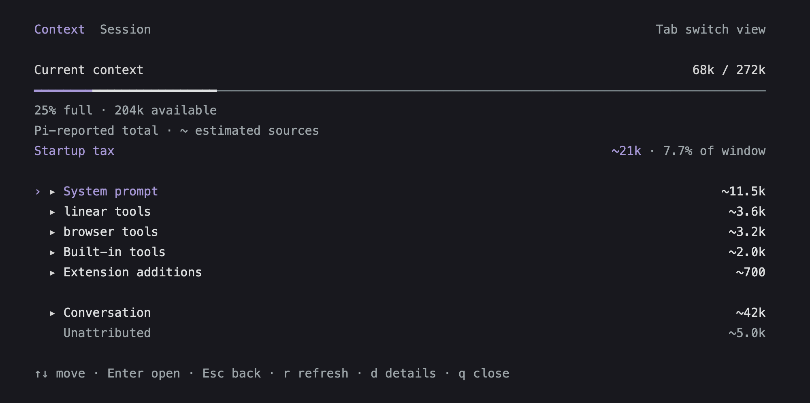
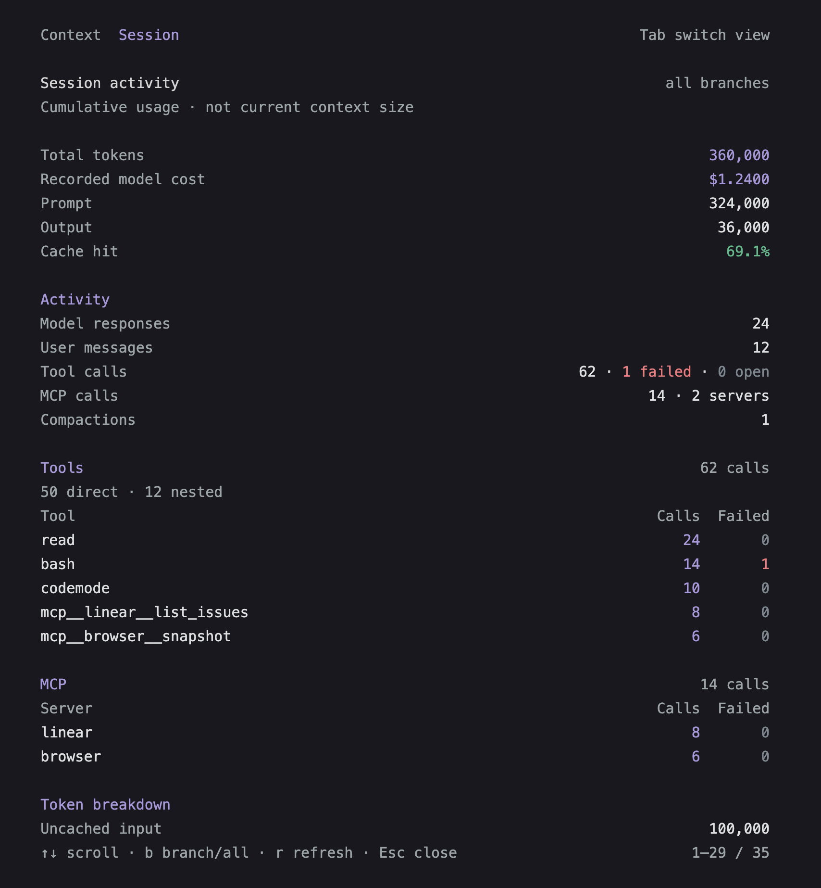
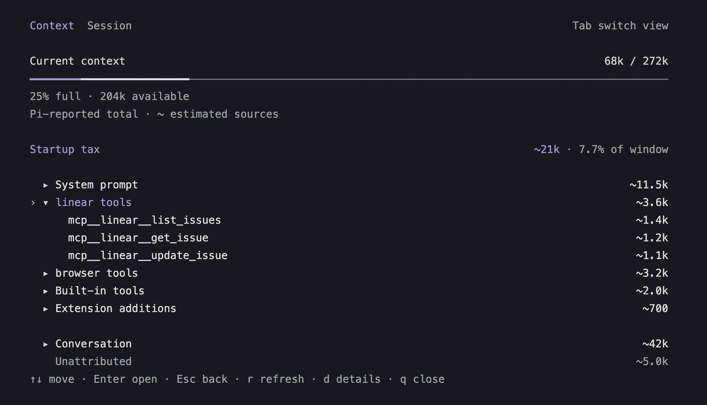
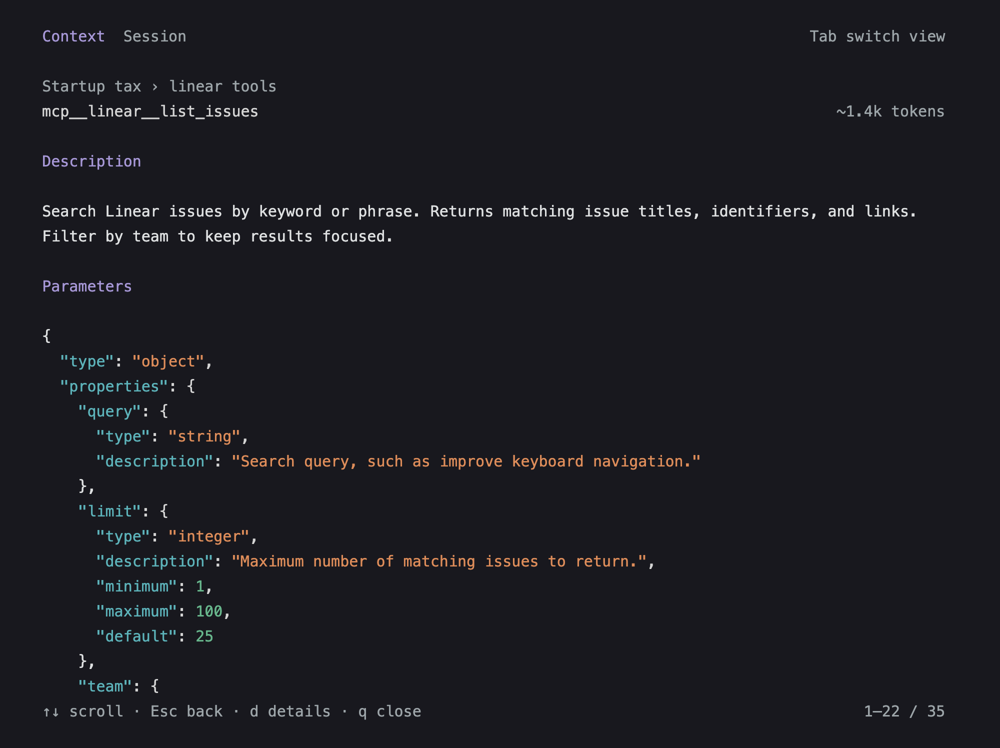
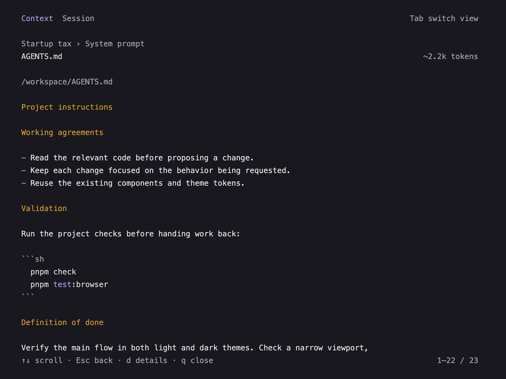
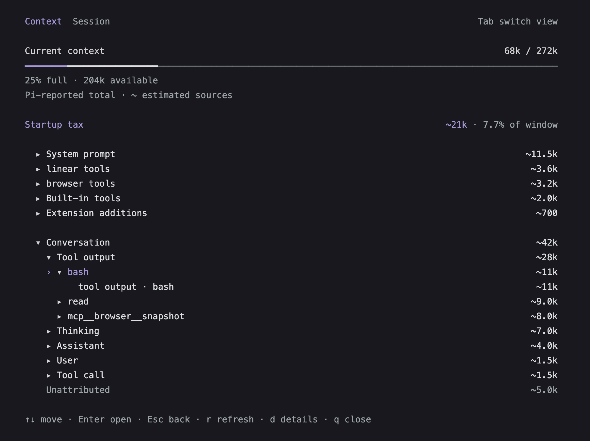
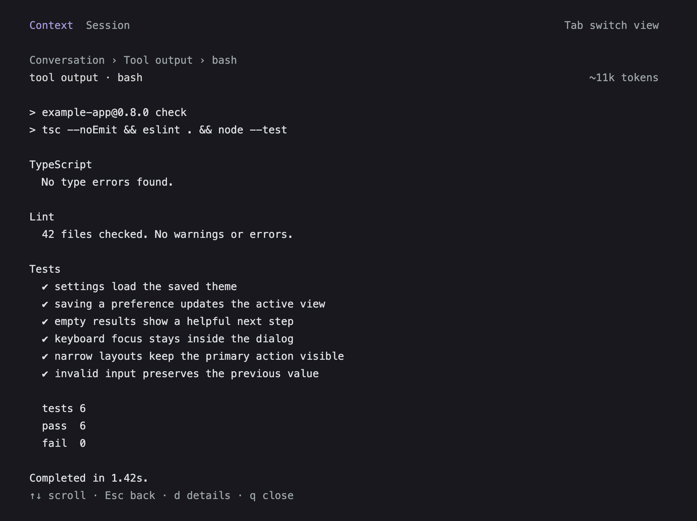

# pi-context-tax

Part of how I work is shipping slop and then converging. I try things, see what sticks, and clean up as I go. My coding environment goes through the same cycle: I try new skills, plugins, and MCPs, and end up keeping things around that I don't need in the long term.

That comes with a startup tax. You open a fresh coding session and 10,000, 20,000, or even 50,000 tokens of your context window can already be taken up by tool definitions and instructions, before you've asked it to do anything.

I've become obsessed with keeping my context clean and my startup tax low. I built `pi-context-tax` to see what's taking up that space, so I can decide what to keep and what to remove.

`pi-context-tax` is a [Pi](https://pi.dev) extension that shows where your context window goes—and what your session has spent. Run `/ctx` to see current usage, available space, and your largest startup costs. Expand a source to inspect its tools, skills, or instructions. Press `Tab` for **Session**: recorded tokens, model cost, cache usage, tool and MCP calls, failures, and unfinished calls. Both views follow your Pi theme.

## Showcase

These screenshots use illustrative session data with Linear and browser tools, rendered by the extension.

### Current context

<picture>
  <source media="(prefers-color-scheme: light)" srcset="docs/context-overview-light.png">
  
</picture>

### Session activity

Press `Tab` to see cumulative usage and recorded calls without confusing them with context occupancy.

<picture>
  <source media="(prefers-color-scheme: light)" srcset="docs/session-activity-light.png">
  
</picture>

### Tool definitions

Expand a provider to see its declared tools, then open one for its description, formatted parameters, and source.





### Instructions

Read the instructions behind a source, with its file path and estimated contribution.



<details>
<summary>Explore the conversation and tool output</summary>

The conversation expands into messages, tool calls, and outputs. Follow a tool to an individual result; long sources scroll without losing their title or token count.





</details>

## Quick start

Install the extension:

```sh
pi install npm:pi-context-tax
```

You can also install directly from GitHub with `pi install git:github.com/Roshvan/pi-context-tax`. Start Pi as usual, then run `/ctx` to open the panel. If Pi is already running, use `/reload` first.

- `Tab` / `Shift+Tab`: switch between Context and Session, keeping your place
- `↑` / `↓`: move through context sources or scroll session activity
- `Enter` / `→`: expand a row or read its source
- `Esc` / `←`: go back (`Esc` closes at the top level)
- `r`: refresh the current view
- `d`: toggle environment details in Context, including skills, context files, command sources, and cumulative usage
- `b`: switch Session between all branches and the current branch
- `q`: close

Navigation, confirmation, cancellation, and page movement follow your Pi `tui.select.*` keybindings; the panel hints show your configured keys. `Tab`, `b`, `r`, `d`, `q`, and the arrow-key expand/back shortcuts remain panel-specific.

Use `Page Up` / `Page Down` to move faster and `Home` / `End` to jump to either end. Source text and session details scroll with the same keys. Opening details from a source and pressing `Esc` returns you to the same place.

Open Session directly with `/ctx session`, or use `/ctx session branch` for the current branch. Export recorded statistics with `/ctx session json` or `/ctx session branch json`. `/ctx summary` is an alias for `/ctx session`; `/ctx branch` and `/ctx json` are shortcuts too.

Session totals are **cumulative traffic, not current context size**. They include recorded assistant, tool-model, compaction, branch-summary, and cache-warming usage. Reasoning tokens are a subset of output, not an extra charge. Tool counts include direct calls and recorded nested calls at every depth; results are not counted again as calls. MCP counts use namespace metadata where available, otherwise tool-name prefixes. An incomplete nested-call record is called out because those counts may be lower bounds. Unrecorded calls and API retries are excluded. History recorded without nested-call records can only show direct calls.

Outside the interactive terminal interface, `/ctx` prints the context report and `/ctx session` prints session activity. RPC uses notifications. In print and JSON event modes, reports, exports, and argument warnings go to stderr, leaving stdout reserved for Pi's model output or JSONL protocol. In the terminal and RPC, invalid arguments produce a UI warning. Both views work in fullscreen and regular terminal modes. The extension adds no model-facing tools; inspecting either view makes no model call and adds no transcript entries.

Startup tax means the tools and standing instructions in your **current** context, including the skill catalog and extension additions. It updates as your environment changes. Loaded skill contents and tool results belong to the conversation. Only model-declared tools are charged as definitions: hidden tools and unactivated deferred tools are not charged separately. Codemode's embedded declarations count within its description. Captured requests use Pi's effective declarations; unchanged recorded loadouts are replayed on reload. Before the first request, or after an unrecorded loadout change, descriptions are estimates from registered definitions, with known hidden tools excluded.

Source counts are estimates, marked `~`. The total uses compatible Pi-reported usage when available, with estimates for newer messages; otherwise it is estimated too. The panel labels which it is. If the source estimates exceed the reported total, they are scaled proportionally to fit it. Any remaining difference is shown as `Unattributed`. Later extension hooks and provider-specific formatting can affect the final context, so this is a guide to cleanup rather than exact billing.

A label such as `Built-in tools · pi-zen` means that extension re-registers Pi’s built-in tools with unchanged descriptions and schemas. Those definitions are counted once; they are not extra tools. An extension that changes a built-in definition is labeled `Built-in overrides` instead.

## Development

You will need Node.js 22.19 or newer, pnpm, and Pi 1.0.4 or newer. Clone the repository, install the dependencies, and start Pi with the local extension:

```sh
git clone https://github.com/Roshvan/pi-context-tax.git
cd pi-context-tax
pnpm install
pnpm dev
```

Before submitting a change, run `pnpm check` and `pnpm pack:check`. Smoke-check the local extension with `/ctx`: switch views, open a source, return from details, toggle branch scope, refresh, and verify `/reload`. Check narrow terminals and light/dark themes too.

Pi supplies the runtime modules through host-provided peers; they are not bundled. Development versions are pinned together in `package.json` and `pnpm-workspace.yaml`.

## Issues and contributions

Issues and pull requests are welcome. If you have an idea, find a bug, or want to improve something, feel free to open an issue or create a pull request. I am happy to look it over.

## License

MIT
